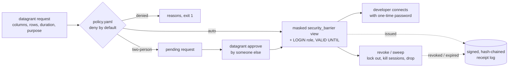

<div align="center">

# datagrant

[](LICENSE)
[](https://github.com/chriswayneh/datagrant/actions/workflows/ci.yml)

### Just-in-time, expiring, masked access to regulated data, with receipts.

An open-source command-line tool that gives developers time-boxed, column- and row-limited, masked access to PHI/PII in Postgres, revokes it automatically, and writes a signed record of who saw what.

**Status:** v0.1.0 is feature-complete on `main` and not yet released. Pre-1.0: interfaces may change. Use fictional or test data until you have reviewed the [security model](docs/security.md). See the [roadmap](ROADMAP.md).

</div>

> **A note on this repo:** This GitHub account is my personal playground, where I experiment, learn, and build security tools in the open. Projects here are personal work, not a product or company offering.

---

## See it in 60 seconds

```bash
git clone https://github.com/chriswayneh/datagrant && cd datagrant
pip install -e .
make demo        # throwaway Postgres in Docker, fake patient data, full flow, auto teardown
```

The demo creates keys, checks a policy, grants alice a masked, west-region-only view for one hour, runs a two-person approval, revokes while a session is open (the session is killed), sweeps an expired grant, and verifies the signed receipt chain. It ends with `DEMO OK`. No Docker? Point it at a scratch database with `DATAGRANT_DEMO_DSN=...`. See [docs/demo.md](docs/demo.md).

In the grantee's view, the identifying columns are redacted, hashed with a keyed HMAC, partially masked or NULL, and only `west` rows appear. Reading the raw table is denied.

## The problem

- **AI and data developers often get standing, over-broad access** to production tables (or full copies) because narrow, time-boxed access is slow to set up by hand.
- **That breaks "minimum necessary"** (HIPAA) and data-minimisation expectations for PII, and the evidence of who saw what is usually a ticket and a hope.
- **datagrant makes the narrow grant the easy path:** ask for specific columns and rows for N hours with a purpose. Policy decides. Access expires on its own, and every step leaves a verifiable receipt.

## How it works



Everything changing is a **dry run unless you pass `--apply`**.

## Install

Python 3.11+. Postgres (CI tests 16) with the `pgcrypto` extension if you use `hash` masks. Not on PyPI yet:

```bash
pip install git+https://github.com/chriswayneh/datagrant.git
datagrant --version
```

## Quick start against your database

```bash
export DATAGRANT_DSN='postgresql://datagrant_admin@db.internal/clinicdb'   # password via ~/.pgpass
export DATAGRANT_POLICY=policy.yaml
datagrant keys init --apply            # hash + signing keys, 0600, ~/.config/datagrant
datagrant policy check policy.yaml
datagrant preflight --apply            # create datagrant state; warn on risky PUBLIC defaults
datagrant request --dataset clinic --table public.patients --columns patient_id,zip \
  --row-filter "region = 'west'" --duration 2h --purpose "debug model drift"          # dry run
datagrant request ... --apply          # prints connection info + one-time password, once
datagrant sweep --apply                # run every minute from cron/systemd
datagrant receipts verify
```

Operating it for real (admin role, scheduling, keys, backups): [runbook](aidlc-docs/operations/runbook.md).

## Policy at a glance

```yaml
version: 1
approval: auto                 # or two-person (needs approvers)
approvers: [security]          # groups allowed to approve two-person requests
max_duration: 8h
groups:
  ml-team: [alice, bob]
  security: [carol]
datasets:
  - name: clinic
    database: clinicdb
    tables:
      - name: public.patients
        allowed_groups: [ml-team]
        max_duration: 4h
        columns:               # only listed columns can be requested
          patient_id: hash     # passthrough | redact | hash | partial | null
          zip: partial
          full_name: redact
          region: passthrough
        row_filters: ["region = 'west'"]
        require_row_filter: true
```

Full reference: [docs/policy.md](docs/policy.md).

## CLI at a glance

| Command | What it does |
| --- | --- |
| `keys init` / `keys export-pubkey` | create hash + signing keys; print the receipt public key |
| `policy check FILE` | validate a policy file offline |
| `request` | ask for access (auto grant, or pending for two-person) |
| `approve REQUEST_ID` | a different person in an approver group approves |
| `grant list` / `grant status ID` | inspect grants |
| `revoke GRANT_ID` | end access now (kills open sessions) |
| `sweep` | revoke expired grants, expire stale requests |
| `receipts verify` | check every signature and the hash chain |
| `preflight` | create state; warn on risky PUBLIC defaults |

Exit codes: `0` ok, `1` denied/failed, `2` usage, `3` receipt not written, `4` revoke failed. Add `--json` anywhere. Full reference: [docs/cli.md](docs/cli.md).

## Security model and honest limits

datagrant narrows and time-boxes access and makes it auditable. It is not an identity provider or a data-loss-prevention system. Read [docs/security.md](docs/security.md) before using it with real data. In short:

- **Identity is not authentication.** The requester is the OS user, or `--as-user`. Anyone holding the admin DSN can claim any name. Real two-person control needs datagrant behind a service that authenticates people and holds the DSN.
- **Columns used in a row filter are visible** to the grantee, because the filter column must be a listed column.
- **Masking still leaks shape:** NULL-ness and value length (partial, hash) are visible.
- **Same-key hashes are linkable** across grants and datasets, since one hash key covers everything.
- **Truncating the newest receipts** is only detected against a head hash you recorded elsewhere (`--expect-head`).
- **Windows has no receipt-log locking** and assumes a single writer.
- **Statement logging** (`log_statement = 'all'`) on the admin connection would log grant SQL, including bound key parameters. Turn it off for the datagrant admin role.

## Documentation

- [Policy reference](docs/policy.md) · [CLI reference](docs/cli.md) · [Security model](docs/security.md) · [Operations](docs/operations.md) · [Demo](docs/demo.md)
- [CHANGELOG.md](CHANGELOG.md) · [ROADMAP.md](ROADMAP.md) · [SECURITY.md](SECURITY.md) · [CONTRIBUTING.md](CONTRIBUTING.md)

## How this project is built

datagrant follows the [AWS AI-DLC](https://github.com/awslabs/aidlc-workflows) workflow: Inception, Construction and Operations, each with a human approval gate. Artifacts live in [`aidlc-docs/`](aidlc-docs/).

## License

MIT. See [LICENSE](LICENSE).
